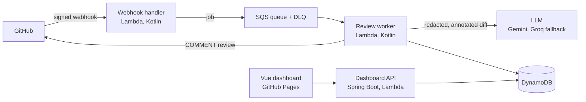

# FirstPass

A GitHub App that posts a first-pass AI code review on pull requests in under two minutes. It only comments: it never approves, blocks, merges or pushes. Humans keep the decision.

> **Status: early development (phase 0, foundations).** The app is not installable yet. This README grows with each phase.

## Why

Pull requests often wait for a reviewer, and simple mistakes (unhandled null, unclosed resource, committed secret, missing test) take senior developers' time. FirstPass catches the obvious problems first, so the human review can focus on design.

## How it works (planned)



1. GitHub sends a signed webhook. The handler verifies the signature, drops duplicates, queues a job and answers within two seconds.
2. The worker fetches the diff, filters files, redacts secrets and sends annotated hunks to the LLM in batches.
3. Only schema-valid findings that land on real diff lines are posted, as a single `COMMENT` review.

## Principles

- **Comment-only.** Reviews are always of type `COMMENT`. Never `APPROVE`, `REQUEST_CHANGES`, push, merge or thread resolution.
- **Untrusted input.** The diff, file names and PR description are treated as data, never as instructions. The model has no tools, and its JSON output is validated against a schema.
- **Privacy.** Secrets are redacted before any LLM call. No diff or prompt is stored. Private repositories are disabled until an admin consents.
- **Low noise.** Confidence threshold, minimum severity, comment cap and deduplication.
- **$0 per month.** AWS always-free allowances only (no S3, no API Gateway), plus free LLM tiers.
- **Accessible and bilingual.** The dashboard targets WCAG 2.1 AA, in English and French.

## Tech stack (planned)

| Layer | Choice |
| --- | --- |
| Backend | Kotlin 2, JVM 21, Gradle Kotlin DSL, hexagonal architecture |
| Event Lambdas | Plain Kotlin (no framework) with Lambda SnapStart |
| Dashboard API | Spring Boot 4 on AWS Lambda |
| Frontend | Vue 3, TypeScript, Vite, Pinia, vue-i18n, Tailwind CSS |
| Data and messaging | DynamoDB (provisioned), SQS |
| Infrastructure as code | Terraform, state in HCP Terraform |
| CI/CD | GitHub Actions, AWS access through OIDC |
| LLM providers | Gemini (primary), Groq (fallback), Ollama (local) |

## Repository layout (target)

```text
backend/    Gradle multi-module build (core, adapters, Lambdas, API)
frontend/   Vue 3 dashboard
infra/      Terraform configuration and tests
eval/       Evaluation cases for review quality
docs/       Architecture decision records and guides
```

## Architecture decisions

Each structural choice, with the alternatives that were rejected and why, is recorded as an ADR in [docs/adr](docs/adr/README.md).

## Getting started

### Local services and configuration

```bash
cp .env.example .env      # then fill in the values; .env is never committed
docker compose up -d      # DynamoDB Local on http://localhost:8000
docker compose --profile ollama up -d   # optional: Ollama, a local LLM (large download)
```

The development GitHub App and the webhook relay are described in [docs/github-app-setup.md](docs/github-app-setup.md).

### Requirements

Requirements so far: JDK 21, Node.js 22.18 or later, and npm 11 to add or update frontend dependencies (npm 10 fails on the current dependency tree). Gradle itself is not needed: the wrapper downloads the right version. For the infrastructure, Terraform 1.16.7, or Docker to run the official images.

### Backend

```bash
cd backend
./gradlew build          # compile, test, ktlint, detekt and coverage checks
./gradlew ktlintFormat   # fix formatting issues
```

On Windows, run the same commands from Git Bash, or use `gradlew.bat` in PowerShell.

### Frontend

```bash
cd frontend
npm ci                    # install the exact versions from package-lock.json
npm run dev               # dashboard on http://localhost:5173
npm run lint              # ESLint, including the no-hardcoded-text rule
npm run test:coverage     # unit tests with the 70 % coverage threshold
npx playwright install chromium   # once, before the first end-to-end run
npm run test:e2e          # end-to-end and accessibility (axe) tests
```

### Infrastructure

No AWS account is needed at this stage: the Terraform tests use a mocked provider.

```bash
cd infra
terraform init -backend=false
terraform validate
terraform test
bash scripts/check-resource-types.sh   # only always-free AWS resource types are allowed
```

Without a local Terraform install, run the official image instead, for example `docker run --rm -v "$PWD:/infra" -w /infra hashicorp/terraform:1.16.7 test`.

## AI-assisted development

This project is built with an AI coding assistant. [AI_USAGE.md](AI_USAGE.md) records what was generated, what was reviewed or changed by hand, and how each part was verified.

## License

Not licensed yet. An open-source license will be added before v1.0.0.

## En français

FirstPass est une GitHub App qui publie une première revue de code par IA sur chaque pull request, en moins de deux minutes. Elle se contente de commenter : elle n'approuve, ne bloque, ne fusionne et ne pousse jamais rien, et la décision reste humaine. Le projet tourne à 0 $ par mois sur les offres gratuites d'AWS et des fournisseurs d'IA. Le dashboard est bilingue et vise la conformité WCAG 2.1 AA. Le projet est en phase 0 (fondations) : l'application n'est pas encore installable.
